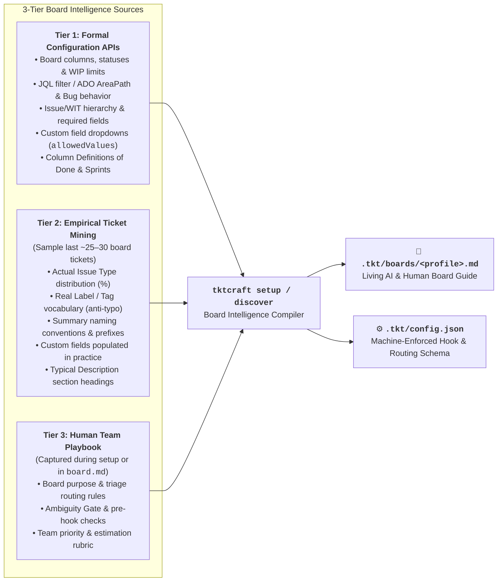
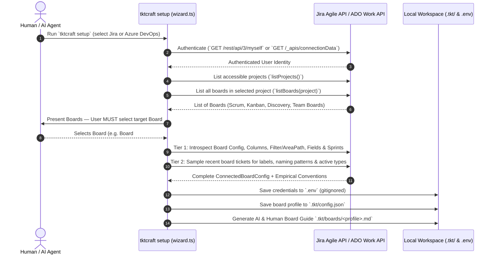
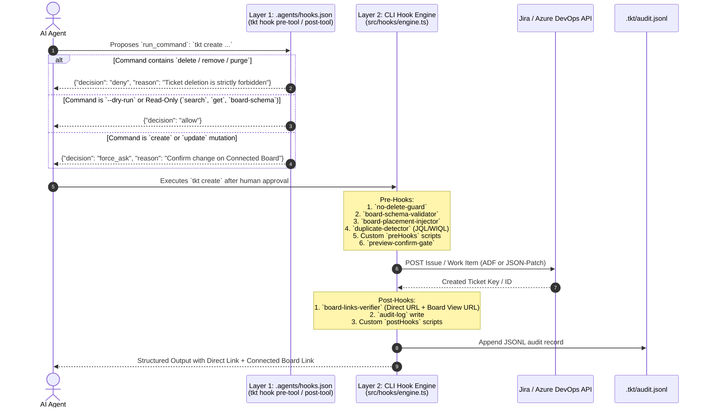

# `tktcraft` (`tkt`) — System Architecture & Board Intelligence Specification

This document records the research findings, architectural decisions, data models, board-intelligence engine (`board.md`), multi-provider formatting pipeline, and dual-layer Pre-Hook / Post-Hook governance system of **`tktcraft`** (CLI binaries: `tktcraft` and `tkt`).

---

## 1. Open-Source Landscape & Why `tktcraft` Exists

### 1.1 GitHub Ecosystem Research Findings
A survey of existing open-source tools across GitHub revealed that **no existing free/open-source tool unifies Jira and Azure DevOps Boards with board-aware setup, structured outputs suited for every board, AI/human onboarding guides, and deterministic AI pre/post-hooks**:

| Category | Existing Open-Source Projects | Architectural Limitations vs. `tktcraft` |
| :--- | :--- | :--- |
| **Jira-Only CLIs** | • `ankitpokhrel/jira-cli` (Go TUI/CLI)<br>• `sofq/jira-cli` (`jr` — OpenAPI-generated CLI with `--preset agent`)<br>• `Aarul5/jira-pilot` (Jira CLI + MCP)<br>• `cesarferreira/jit` | **Single-vendor (Jira only).** No Azure DevOps support, no dynamic board-column/filter introspection into a living `board.md`, and no built-in pre/post-hook governance. |
| **Azure DevOps-Only CLIs** | • `Azure/azure-devops-cli-extension` (`az boards`)<br>• `charlintosh/lazyado` (Bubble Tea TUI for ADO work items) | **Single-vendor (ADO only).** `az boards` requires verbose raw field paths (`--fields System.Title=...`), lacks Markdown-to-HTML multi-field splitting (`AcceptanceCriteria` / `ReproSteps`), and has no AI safety hooks. |
| **Git Branch / Workflow Bridges** | • `Nils-dev-mertens/flowlane` (Jira + ADO ticket-to-branch-to-PR CLI) | Automates Git branch/PR naming from ticket IDs, but does not manage board schemas, ticket authoring templates, or AI guardrails. |
| **Vendor MCP Servers** | • `atlassian/atlassian-mcp-server` (Rovo MCP)<br>• `sooperset/mcp-atlassian`<br>• `microsoft/azure-devops-mcp` | Separate servers per vendor, high per-turn token overhead, no board-placement awareness, and unable to enforce deterministic pre-hook confirmation or board-specific field gates. |

---

### 1.2 Why CLI + Skills + Hooks Over Raw MCP? (What We Learned from MCP)

When evaluating whether to rely on raw **Jira / Azure DevOps MCP servers** versus building **`tktcraft` (CLI + Agent Skill + Pre/Post-Hooks)**, we analyzed real production usage of Atlassian Rovo MCP and Azure DevOps MCP:

| Dimension | Raw Jira / ADO MCP Servers (`atlassian-mcp`, `azure-devops-mcp`) | `tktcraft` CLI + `.agents/skills/tkt-ops` + Pre/Post-Hooks |
| :--- | :--- | :--- |
| **Context Window & Token Efficiency** | Loads 15–30 verbose JSON tool schemas into the LLM context on **every single conversation turn**, burning thousands of tokens even when no ticket operations occur. | **Zero idle token cost.** Progressive disclosure loads `.agents/skills/tkt-ops/SKILL.md` only when ticket work is requested, and `--format agent` returns compact, token-efficient JSON. |
| **Pre-Hook Governance & Read/Write Safety** | MCP servers often multiplex writes through generic tools (e.g., `executeWrite`), making tool-name deny lists ineffective at enforcing fine-grained rules (such as blocking deletes while allowing comments, or requiring human confirmation per board). | **Deterministic Dual-Layer Pre-Hooks:** Both `.agents/hooks.json` (`PreToolUse`) and the `tktcraft` CLI engine hard-block `delete`/`remove`/`purge` and force a structured human confirmation preview (`force_ask`) before any `create` or `update`. |
| **Board Placement Awareness** | Creates tickets at the flat project level — frequently missing the board's JQL filter label (`labels = EAE-Implementation`) or ADO Team `AreaPath`, causing AI-created tickets to vanish from the team's board. | **Mandatory Board Selection at Setup:** `tktcraft setup` forces choosing a target board, introspects its filter/settings, and automatically injects required board labels (Jira) or `AreaPath`/`IterationPath` (ADO). |
| **Authentication Simplicity** | Remote MCP servers require per-site browser OAuth grants or special service-account tokens with fixed, non-editable scopes that expire silently. | Uses standard, developer-friendly `.env` API tokens (`JIRA_TOKEN`, `ADO_TOKEN`) supporting Jira Cloud, Jira Data Center, and Azure DevOps Services/Server. |
| **Best MCP Patterns Adopted into `tktcraft`** | • `discover` / `createmeta` schema inspection<br>• Pre-creation duplicate search<br>• `Filed by:` attribution & git context enrichment | **Built natively into `tktcraft`:**<br>• `tktcraft discover` / `tktcraft board-schema`<br>• Automatic duplicate detection in `tktcraft create` pre-hook<br>• `Filed by:` provenance in all board templates |

---

## 2. Core Architectural Pillars

Most issue-tracker tools treat Jira and Azure DevOps as **flat project databases**. In reality, product and engineering teams work on **Boards** — and different boards inside the *same* project often have completely different workflows, issue types, columns, and rules (e.g., a *Product Discovery Board* vs. an *Engineering Sprint Board* vs. a *Bug Triage Board*).

`tktcraft` is built around **five architectural pillars**:
1. **Mandatory Board Selection During Setup (`tktcraft setup`)**: Users and AI agents must explicitly choose which board to connect to (supporting multiple named board profiles in `.tkt/config.json`).
2. **3-Tier Board Intelligence & Living `board.md` Generation**: Combines **(1) Formal API Schema Introspection**, **(2) Empirical Mining of Recent Board Tickets**, and **(3) Human Playbook & Gatekeeping Rules** into `.tkt/boards/<profile>.md` (and `board.md`).
3. **Board-Adaptive Multi-Field Formatting**: Automatically converts unified Markdown into **Jira ADF v1** or splits it across **Azure DevOps's dedicated board fields** (`System.Description`, `Microsoft.VSTS.Common.AcceptanceCriteria`, `Microsoft.VSTS.TCM.ReproSteps`, `Microsoft.VSTS.TCM.SystemInfo`).
4. **Dual-Layer Pre-Hooks & Post-Hooks**: Enforces safety, duplicate detection, board schema validation, preview confirmation, audit logging, and post-execution **Direct Ticket + Connected Board View deep-links** at both the AI Agent Harness layer and the CLI layer.
5. **Zero Runtime Dependencies & Multi-Format Structured Outputs (`human`, `agent`, `json`, `md`)**.

---

## 3. High-Level System Architecture

```mermaid
flowchart TB
    subgraph Actors["1. Callers (Human & AI Agents)"]
        Human["👤 Human Developer / PM<br/>(Interactive Terminal)"]
        Agent["🤖 AI Coding Agent<br/>(Claude Code / Antigravity / Cursor / Codex)"]
    end

    subgraph HarnessLayer["2. AI Agent Harness Layer (.agents/)"]
        Skill["📘 Skill & Onboarding Guide<br/><code>.agents/skills/tkt-ops/SKILL.md</code><br/><code>SETUP.md</code> + <code>.tkt/boards/&lt;profile&gt;.md</code>"]
        HooksJson["🛡️ Agent Lifecycle Hooks<br/><code>.agents/hooks.json</code><br/>• <code>PreToolUse</code> -> <code>tkt hook pre-tool</code><br/>• <code>PostToolUse</code> -> <code>tkt hook post-tool</code>"]
    end

    subgraph CliCore["3. tktcraft CLI Core (Zero-Dependency TypeScript / Node.js)"]
        Router["⚡ CLI Dispatcher<br/><code>src/cli.ts</code> (<code>tktcraft</code> / <code>tkt</code>)"]
        Wizard["🧭 Setup & Board Intelligence Engine<br/><code>src/setup/wizard.ts</code>"]
        CfgMgr["🗂️ Config, Profile & board.md Manager<br/><code>src/config/manager.ts</code><br/>(<code>.tkt/config.json</code> + <code>.env</code> + <code>.tkt/boards/*.md</code>)"]
        HookEngine["🔒 CLI Pre-Hook & Post-Hook Engine<br/><code>src/hooks/engine.ts</code>"]
        Formatters["📐 Structured Formatters<br/>• <code>markdown-adf.ts</code> (Jira ADF v1)<br/>• <code>markdown-ado.ts</code> (ADO HTML + Field Splitter)<br/>• <code>output.ts</code> (human | agent | json | md)"]
    end

    subgraph Providers["4. Provider Adapters (src/providers/)"]
        JiraProv["🟦 JiraProvider (<code>jira.ts</code>)<br/>• Jira Cloud REST v3 + Data Center v2<br/>• Agile Board API v1.0 & Filter JQL Parser<br/>• Createmeta, Sprints, Transitions & Ticket Mining"]
        AdoProv["🔷 AdoProvider (<code>ado.ts</code>)<br/>• Azure DevOps REST v7.1 (WIQL + JSON-Patch)<br/>• Team Board Columns, DoD & TeamSettings API<br/>• Work Item Type Schema & Ticket Mining"]
    end

    Human --> Router
    Agent --> Skill
    Agent --> HooksJson
    HooksJson --> Router
    Router --> Wizard
    Router --> CfgMgr
    Router --> HookEngine
    HookEngine --> Formatters
    HookEngine --> JiraProv
    HookEngine --> AdoProv
```



---

## 4. Deep Board Intelligence: What We Collect to Understand How a Team Works (`board.md`)

To let an AI agent (or new team member) work seamlessly on any Jira or Azure DevOps board without hardcoded rules, `tktcraft` collects **three tiers of board intelligence** and compiles them into `.tkt/boards/<profile>.md` (and `board.md`).



### 4.1 Tier 1: What We Extract Directly from Jira & Azure DevOps Configuration APIs

| Intelligence Domain | Extracted from **Jira** (REST v3 + Agile v1.0) | Extracted from **Azure DevOps** (REST v7.1 Work + WIT) | Why `tktcraft` & the AI Need It |
| :--- | :--- | :--- | :--- |
| **1. Board Filter & Auto-Placement Rules** | • `/rest/agile/1.0/board/{id}/configuration`<br>• Saved Filter ID $\rightarrow$ `/rest/api/3/filter/{id}` (**full JQL query**)<br>• Extracted required filter labels (`labels = ...`), components, or issue types<br>• Swimlane strategy (Epic, Assignee, JQL, Story) & Card layout fields | • `/_apis/work/boards/{id}`<br>• Backlog level (`Epics`, `Features`, `Stories`, `Tasks`)<br>• `/_apis/work/teamsettings/teamfieldvalues` (exact **`System.AreaPath`** values included on the board)<br>• `/_apis/work/teamsettings` (**Bug behavior**: `asRequirements` vs `asTasks`)<br>• Card fields & styling rules | Guarantees that every ticket created by the AI automatically receives the required JQL label (Jira) or `AreaPath` / `IterationPath` (ADO) so it **always appears on the board**. |
| **2. Columns $\leftrightarrow$ Statuses, WIP & Column DoD** | • `columnConfig.columns`: Ordered visual column names, min/max **WIP limits**, and mapped `status.id` $\rightarrow$ Status Name & Status Category (`To Do`, `In Progress`, `Done`) | • `columns[]`: Visual column names, WIP (`itemLimit`), **Split columns** (*Doing* vs *Done*), `stateMappings` per Work Item Type, and **Column Definition of Done (`col.description`)** | Allows users/AI to move tickets by **visual column name** (`--column "Tech Assessment"`) and gives the AI the team's exact **Definition of Done** per column! |
| **3. Workflow Transitions & Transition Gates** | • `/rest/api/3/issue/{key}/transitions?expand=transitions.fields`<br>• Valid transitions from current state + **fields required during transition** (e.g. `Resolution` or `Fix Version` when closing) | • `/_apis/wit/workitemtypes/{type}` (`states` & `transitions` graph)<br>• Valid `fromState -> toState` paths and allowed `Reason` values | Prevents illegal status jumps and alerts the AI when moving a ticket to a column requires an extra field. |
| **4. Issue / Work-Item Hierarchy** | • `/rest/api/3/project/{key}` (`hierarchyLevel`: `1` = Initiative/Epic, `0` = Story/Task/Bug, `-1` = Sub-task) | • `/_apis/work/processconfiguration`<br>• Process template (`Agile`, `Scrum`, `CMMI`, `Basic`, or Inherited) & hierarchy (`Epic -> Feature -> User Story/PBI -> Task`) | Teaches the AI how parent-child linking works on this board (`fields.parent` in Jira vs `System.LinkTypes.Hierarchy-Reverse` in ADO). |
| **5. Field Schemas, Picklists & Admin HelpText** | • `/rest/api/3/issue/createmeta/{project}/issuetypes/{id}`<br>• Required vs optional fields, `customfield_*` display names, types, default values, and **`allowedValues` dropdown options** (e.g., Strategic Themes, Priorities, Components) | • `/_apis/wit/workitemtypes/{type}/fields?$expand=all`<br>• `alwaysRequired`, `defaultValue`, `allowedValues` picklists, **`helpText` admin tooltips**, and dedicated rich-text fields (`AcceptanceCriteria`, `ReproSteps`, `SystemInfo`) | Eliminates HTTP 400 field errors and teaches the AI all valid custom dropdown options (e.g., Strategic Themes) without hardcoding. |
| **6. Sprints, Components & Team Roster** | • `/rest/agile/1.0/board/{id}/sprint?state=active,future` (Active Sprint name, start/end dates, **Sprint Goal**)<br>• `/project/{key}/components` (Components & default leads)<br>• `/user/assignable/search` (Assignable team members) | • `/teamsettings/iterations` (Current & upcoming iterations + dates)<br>• `/classificationNodes/Areas?$depth=3` (Sub-area tree)<br>• `/projects/{proj}/teams/{team}/members` (Team roster) | Gives the AI active sprint goals, valid module components, and real assignee identities. |

---

### 4.2 Tier 2: What We Mine Empirically from Recent Board Tickets ("How the Team *Actually* Works")

Formal project schemas in Jira and Azure DevOps often accumulate clutter over years — a project may define 12 issue types and 60 custom fields, while a specific team board only uses 3 of them.

By sampling the **last 25–30 tickets on the connected board** during `tktcraft setup` / `tktcraft discover`, `tktcraft` extracts empirical team conventions for `board.md`:
1. **Actual Issue Type Breakdown on This Board**:
   - Computes the real percentage of each issue type on the board (e.g., discovering that Board `#4893` is 92% `Initiative` and 8% `Epic`, whereas Board `#4887` is 55% `Story`, 30% `Task`, and 15% `Bug`).
2. **Active Label / Tag Vocabulary (Anti-Hallucination Catalog)**:
   - Jira and Azure DevOps silently create new labels/tags whenever a typo is passed.
   - Mining existing board tickets builds a ranked list of **real labels/tags currently used on the board** (e.g., `EAE-Implementation`, `security`, `business_req_for_agent`) so the AI only applies verified team labels.
3. **Summary / Title Naming Pattern Detection**:
   - Analyzes existing ticket summaries to detect team naming conventions — such as bracketed domain/client prefixes (`[<Domain/Client>] <Verb> <Outcome>`), conventional commit prefixes (`feat: ...`), or plain sentence case — and embeds 3–5 real ticket titles into `board.md` as few-shot examples.
4. **Custom Fields Populated in Practice & Parent-Link Rate**:
   - Identifies which optional custom fields are actually populated on $>20\%$ of tickets on this board (filtering out dead legacy fields) and measures what percentage of Stories/Tasks link to a parent `Epic` or `Feature`.
5. **Observed Description Section Structure**:
   - Extracts recurring Markdown/HTML headings used by the team inside ticket descriptions (e.g., `## Background`, `## Scope`, `## Acceptance Criteria`, `## Out of Scope`).

---

### 4.3 Tier 3: What APIs Cannot Tell Us (Human Playbook Context in `board.md`)

Three pieces of team workflow knowledge live in the team's operating agreements rather than tracker APIs, and are captured in the editable Playbook section of `board.md`:
1. **Board Intent & Cross-Board Routing Rule**: When should work be filed on *this* board versus another board in the project? (e.g., *"Unvetted product ideas go to Discovery Board #4893; approved engineering stories go to Implementation Board #4887"*).
2. **Pre-Hook Gatekeeping & Ambiguity Rules**: What conditions forbid the AI from creating a ticket immediately? (e.g., *"If Ambiguity is HIGH, halt and present 2–3 grounded questions with pre-researched defaults before creating the ticket"*).
3. **Business Priority & Sizing Rubric**: How business impact maps to `Showstopper` / `Critical` / `Major` / `Minor` (or P0–P4) for this team.

---

## 5. Mandatory Board Selection & Introspection Flow (`tktcraft setup`)

During `tktcraft setup` (or `tktcraft discover`), the user or AI agent **must select which board to connect to**.



---

## 6. Multi-Provider Data Normalization & Smart Field Routing

### 6.1 Jira Cloud & Data Center (`JiraProvider`)
- **Authentication**:
  - Jira Cloud (`authType: "cloud"`): `Authorization: Basic base64(email:api_token)` against REST API v3 (`/rest/api/3/*`).
  - Jira Data Center (`authType: "datacenter"`): `Authorization: Bearer <PAT>` against REST API v2 (`/rest/api/2/*`).
- **Markdown $\leftrightarrow$ ADF v1 (`src/formatters/markdown-adf.ts`)**:
  - Converts Markdown headings (`#`–`######`), Markdown tables (`| col | col |`), bullet lists, numbered lists, interactive task checkboxes (`[ ]` $\rightarrow$ `☐`, `[x]` $\rightarrow$ `☑`), fenced code blocks (` ```lang `), blockquotes (`>`), and inline marks (`**bold**`, `*italic*`, `` `code` ``, `[link](url)`) into valid Atlassian Document Format JSON.
- **Automatic JQL Filter Label Injection**:
  - `extractRequiredLabelsFromJql()` parses the connected board's saved JQL filter (e.g., `project = AIEAE AND labels = EAE-Implementation`).
  - When `tktcraft create` runs on that board profile, `EAE-Implementation` is automatically merged into `fields.labels`.

### 6.2 Azure DevOps Boards (`AdoProvider`)
- **Authentication**:
  - PAT mode (`authType: "pat"`): `Authorization: Basic base64(":PAT")` against Azure DevOps REST API v7.1.
- **Multi-Field Splitting (`src/formatters/markdown-ado.ts`)**:
  - Azure DevOps work item forms separate fields by card/process type (`Agile`, `Scrum`, `CMMI`, `Basic`). Notably, **Bug** work items on default Azure DevOps boards display `Microsoft.VSTS.TCM.ReproSteps` instead of `System.Description`, and **User Stories / PBIs** display `Microsoft.VSTS.Common.AcceptanceCriteria` in a dedicated tab.
  - `splitMarkdownForAdoBoard()` takes a single unified Markdown document from the AI or human and automatically splits:
    - Main description $\rightarrow$ `/fields/System.Description` (HTML)
    - `## Acceptance Criteria` $\rightarrow$ `/fields/Microsoft.VSTS.Common.AcceptanceCriteria` (HTML)
    - `## Repro Steps` $\rightarrow$ `/fields/Microsoft.VSTS.TCM.ReproSteps` (HTML; also used as primary body fallback for `Bug` work items)
    - `## System Info` $\rightarrow$ `/fields/Microsoft.VSTS.TCM.SystemInfo` (HTML)
- **Automatic Board Placement & Hierarchy Linking**:
  - Injects `/fields/System.AreaPath` and `/fields/System.IterationPath` from the connected Team's discovered settings.
  - Formats tags as semicolon-separated strings (`/fields/System.Tags`) and queries them in WIQL using parenthesized `[System.Tags] CONTAINS '...'` clauses (`buildWiqlTagsClause()`).
  - Links parent Epics/Features/Stories via `application/json-patch+json` relation `System.LinkTypes.Hierarchy-Reverse`.

---

## 7. Dual-Layer Pre-Hook & Post-Hook Governance Architecture

To guarantee safety when AI agents create or update tickets, `tktcraft` implements hooks at **two independent layers**:



### 7.1 Layer 1: AI Agent Harness Hooks (`src/hooks/agent-harness.ts`)
Configured via [.agents/hooks.json](.agents/hooks.json):
- **`PreToolUse` (`tkt hook pre-tool`)**:
  - Reads the tool-call JSON from `stdin`.
  - Returns `{"decision": "deny"}` if any command targeting `tktcraft`, `tkt`, `jira`, or `az boards` attempts a `delete`, `remove`, `destroy`, `drop`, or `purge`.
  - Returns `{"decision": "allow"}` for read-only commands (`get`, `search`, `me`, `boards`, `board-schema`, `discover`, `transitions`) and `--dry-run` previews.
  - Returns `{"decision": "force_ask"}` with the connected board name and command summary for any `create`, `update`, `transition`, or `comment` command.
- **`PostToolUse` (`tkt hook post-tool`)**:
  - Verifies post-execution output and returns `{}` per the agent harness `PostToolUse` protojson contract.

### 7.2 Layer 2: Built-In CLI Pre-Hooks & Post-Hooks (`src/hooks/engine.ts`)
Even when `tktcraft` is run outside an AI harness (e.g., directly by a human in `zsh`/`bash` or by CI scripts), the CLI enforces:
- **Built-in Pre-Hooks**:
  1. `no-delete-guard`: Exits with code `2` if any forbidden deletion flag/subcommand is present.
  2. `board-schema-validator`: Checks the requested `--type` and required fields against the connected board's discovered schema in `.tkt/config.json`.
  3. `board-placement-injector`: Injects required board labels (Jira) or default team `AreaPath`/`IterationPath` (Azure DevOps).
  4. `duplicate-detector`: Queries the tracker for existing tickets matching distinctive keywords from `--summary` and surfaces matches in the preview box.
  5. `preview-confirm-gate`: Renders the `[PRE-HOOK PREVIEW]` table and requires interactive `[y/N]` confirmation or `--yes`.
- **Built-in Post-Hooks**:
  1. `board-links-verifier`: Computes and outputs both the **Direct Ticket Link** (`/browse/KEY` or `/_workitems/edit/ID`) and the **Connected Board View Link** (`?selectedIssue=KEY` or `?workitem=ID`).
  2. `audit-log`: Appends an immutable JSONL record to `.tkt/audit.jsonl`.
  3. `custom-post-hooks`: Runs any shell commands or webhooks configured in `.tkt/config.json` (`governance.postHooks`) with `TKT_TICKET_KEY`, `TKT_DIRECT_URL`, `TKT_BOARD_URL`, and `TKT_BOARD_COLUMN` environment variables.

---

## 8. Repository & Module Structure

```text
tkt_management_cli/
├── bin/
│   └── tkt.js                        # Executable CLI entry point (`tktcraft` and `tkt`)
├── src/
│   ├── cli.ts                        # Command-line argument parser & subcommand dispatcher
│   ├── types.ts                      # Unified Ticket, ConnectedBoardConfig, Profile, and Hook contracts
│   ├── config/
│   │   └── manager.ts                # .env + .tkt/config.json loader, profile auto-detection & board.md generator
│   ├── setup/
│   │   └── wizard.ts                 # Interactive & CLI-flag setup wizard with mandatory board selection
│   ├── providers/
│   │   ├── base.ts                   # Abstract TrackerProvider interface
│   │   ├── jira.ts                   # Jira Cloud/DC client, Agile board/filter parser, duplicate search & CRUD
│   │   └── ado.ts                    # Azure DevOps client, Team board/settings introspection, WIQL & JSON-Patch
│   ├── formatters/
│   │   ├── markdown-adf.ts           # Bidirectional Markdown <-> Atlassian Document Format (ADF v1)
│   │   ├── markdown-ado.ts           # Bidirectional Markdown <-> ADO HTML + AC/Repro/SystemInfo field splitter
│   │   └── output.ts                 # Structured output renderer (human, agent, json, md)
│   └── hooks/
│       ├── engine.ts                 # Built-in CLI Pre-Hooks, Confirmation Gate, Audit Logger & Custom Hooks
│       └── agent-harness.ts          # PreToolUse & PostToolUse JSON protocol handler for AI coding agents
├── .agents/
│   ├── hooks.json                    # Agent lifecycle hook bindings
│   ├── bin/tkt.js                    # Relative CWD shim for .agents/ hook execution
│   └── skills/tkt-ops/
│       ├── SKILL.md                  # AI Agent operating playbook & governance rules
│       └── assets/                   # Board-ready templates (story, bug, epic, initiative)
├── tests/
│   └── tkt.test.ts                   # Automated test suite (node:test)
├── SETUP.md                          # Human & AI Connection + Board Selection Guide
├── ARCHITECTURE.md                   # System architecture specification (this document)
├── AGENTS.md                         # Workspace directives for AI agents
└── README.md                         # Package documentation & quickstart
```

---

## 9. Security & Secret Isolation

- **Secrets Never Touch `.tkt/config.json` or `board.md`**: API tokens (`JIRA_TOKEN`, `ADO_TOKEN`) and user emails live exclusively in `.env` (which is gitignored) or environment variables.
- **Shareable Board Profiles**: `.tkt/config.json` and `.tkt/boards/<profile>.md` store only non-secret board metadata (board IDs, column-to-status maps, required label rules, empirical conventions, and field definitions), making them safe to inspect or commit to a team repository.
