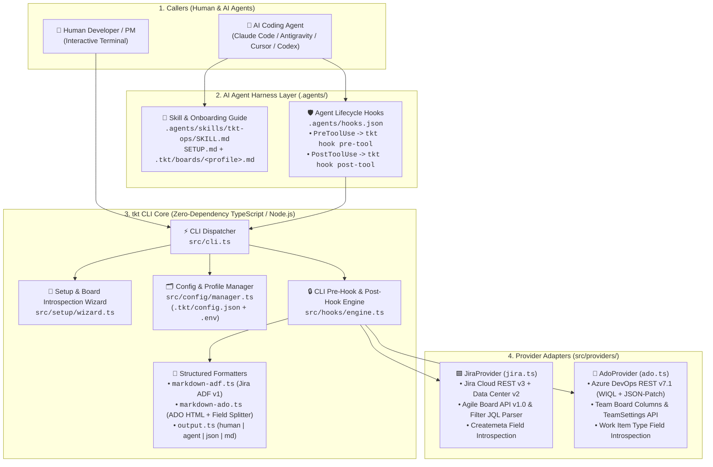
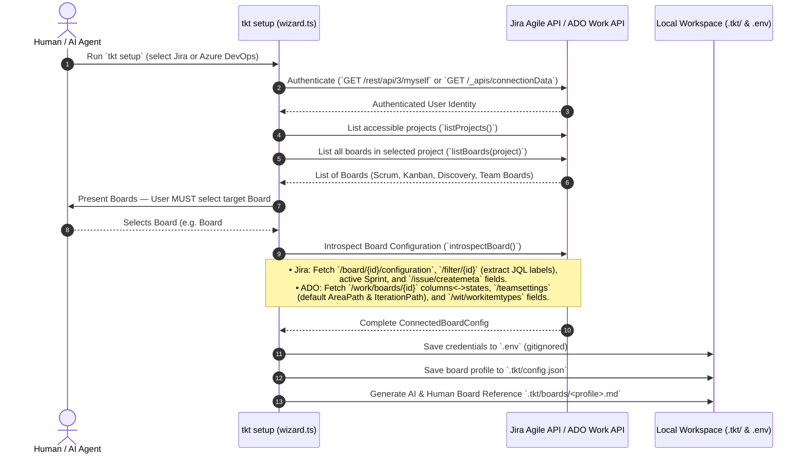
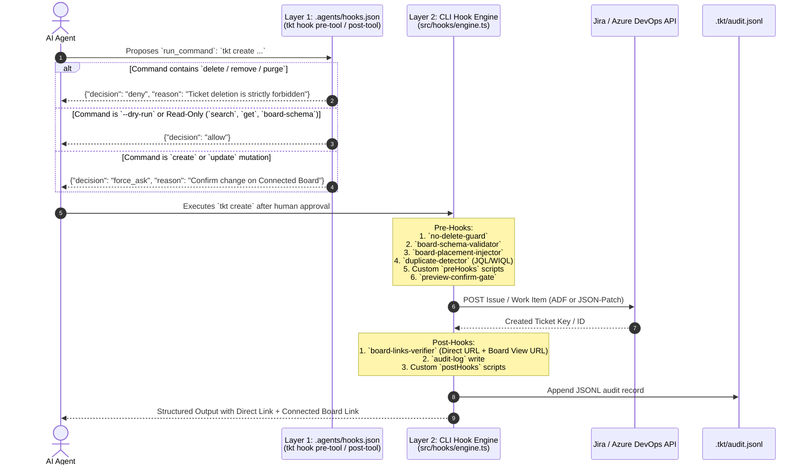

# `tkt` (`tkt-board-cli`) — System Architecture

This document describes the architecture, data models, board-introspection engine, multi-provider formatting pipeline, and dual-layer Pre-Hook / Post-Hook governance system of **`tkt`** (`tkt-board-cli`).

---

## 1. Architectural Philosophy: Why Board-First CLI + Hooks?

Most issue-tracker integrations (whether traditional CLIs like `az boards` / `jira-cli` or raw MCP servers like `atlassian-mcp` / `azure-devops-mcp`) treat Jira and Azure DevOps as **flat project databases**. In real engineering and product organizations, teams do not work in flat project databases — **they work on Boards**:
- A **Product Discovery Board** has custom columns (`💡 Idea Captured` $\rightarrow$ `💬 Product Discussion` $\rightarrow$ `🔬 Tech Assessment`) mapped to underlying Jira statuses, and requires specific strategic fields.
- An **Engineering Implementation Board** in Jira often filters issues via a saved JQL filter (e.g., `project = AIEAE AND labels = EAE-Implementation`). Creating a ticket in the project *without* that filter label means the ticket **never appears on the team's board**.
- An **Azure DevOps Team Board** filters work items by the team's `System.AreaPath` and `System.IterationPath`, and splits ticket bodies across distinct fields depending on the work item type (`System.Description`, `Microsoft.VSTS.Common.AcceptanceCriteria`, `Microsoft.VSTS.TCM.ReproSteps`, `Microsoft.VSTS.TCM.SystemInfo`).

`tkt` solves this with four architectural pillars:
1. **Mandatory Board Selection & Deep Introspection at Setup (`tkt setup`)**
2. **Board-Adaptive Multi-Field Formatting (Jira ADF v1 $\leftrightarrow$ Markdown $\leftrightarrow$ ADO Split-HTML)**
3. **Dual-Layer Pre-Hooks & Post-Hooks (AI Harness Layer + CLI Execution Layer)**
4. **Zero-Dependency Runtime & Multi-Format Structured Outputs (`human`, `agent`, `json`, `md`)**

---

## 2. High-Level System Architecture



---

## 3. Repository & Module Structure

```text
tkt_management_cli/
├── bin/
│   └── tkt.js                        # Executable CLI entry point (runs dist/cli.js or native TS fallback)
├── src/
│   ├── cli.ts                        # Command-line argument parser & subcommand dispatcher
│   ├── types.ts                      # Unified Ticket, ConnectedBoardConfig, Profile, and Hook contracts
│   ├── config/
│   │   └── manager.ts                # .env + .tkt/config.json loader, profile auto-detection & board URL builder
│   ├── setup/
│   │   └── wizard.ts                 # Interactive & CLI-flag setup wizard with mandatory board selection
│   ├── providers/
│   │   ├── base.ts                   # Abstract TrackerProvider interface
│   │   ├── jira.ts                   # Jira Cloud/DC client, Agile board/filter parser, duplicate search & CRUD
│   │   └── ado.ts                    # Azure DevOps client, Team board/settings introspection, WIQL & JSON-Patch
│   ├── formatters/
│   │   ├── markdown-adf.ts           # Bidirectional Markdown <-> Atlassian Document Format (ADF v1)
│   │   ├── markdown-ado.ts           # Bidirectional Markdown <-> ADO HTML + AC/Repro/SystemInfo field splitter
│   │   └── output.ts                 # Structured output renderer (human, agent, json, md)
│   └── hooks/
│       ├── engine.ts                 # Built-in CLI Pre-Hooks, Confirmation Gate, Audit Logger & Custom Hooks
│       └── agent-harness.ts          # PreToolUse & PostToolUse JSON protocol handler for AI coding agents
├── .agents/
│   ├── hooks.json                    # Agent lifecycle hook bindings
│   ├── bin/tkt.js                    # Relative CWD shim for .agents/ hook execution
│   └── skills/tkt-ops/
│       ├── SKILL.md                  # AI Agent operating playbook & governance rules
│       └── assets/                   # Board-ready templates (story, bug, epic, initiative)
├── tests/
│   └── tkt.test.ts                   # Automated test suite (node:test)
├── SETUP.md                          # Human & AI Connection + Board Selection Guide
├── ARCHITECTURE.md                   # System architecture specification (this document)
├── AGENTS.md                         # Workspace directives for AI agents
└── README.md                         # Package documentation & quickstart
```

---

## 4. Mandatory Board Selection & Introspection Flow (`tkt setup`)

During `tkt setup` (or `tkt discover`), the user or AI agent **must select which board to connect to**. Once a board is chosen, `tkt` performs deep API introspection so that future ticket operations require zero hardcoded IDs.



---

## 5. Multi-Provider Data Normalization & Smart Field Routing

### 5.1 Jira Cloud & Data Center (`JiraProvider`)
- **Authentication**:
  - Jira Cloud (`authType: "cloud"`): `Authorization: Basic base64(email:api_token)` against REST API v3 (`/rest/api/3/*`).
  - Jira Data Center (`authType: "datacenter"`): `Authorization: Bearer <PAT>` against REST API v2 (`/rest/api/2/*`).
- **Markdown $\leftrightarrow$ ADF v1 (`src/formatters/markdown-adf.ts`)**:
  - Converts Markdown headings (`#`–`######`), Markdown tables (`| col | col |`), bullet lists, numbered lists, interactive task checkboxes (`[ ]` $\rightarrow$ `☐`, `[x]` $\rightarrow$ `☑`), fenced code blocks (` ```lang `), blockquotes (`>`), and inline marks (`**bold**`, `*italic*`, `` `code` ``, `[link](url)`) into valid Atlassian Document Format JSON.
- **Automatic JQL Filter Label Injection**:
  - `extractRequiredLabelsFromJql()` parses the connected board's saved JQL filter (e.g., `project = AIEAE AND labels = EAE-Implementation`).
  - When `tkt create` runs on that board profile, `EAE-Implementation` is automatically merged into `fields.labels`.

### 5.2 Azure DevOps Boards (`AdoProvider`)
- **Authentication**:
  - PAT mode (`authType: "pat"`): `Authorization: Basic base64(":PAT")` against Azure DevOps REST API v7.1.
- **Multi-Field Splitting (`src/formatters/markdown-ado.ts`)**:
  - Azure DevOps work item forms separate fields by card/process type (`Agile`, `Scrum`, `CMMI`, `Basic`). Notably, **Bug** work items on default Azure DevOps boards display `Microsoft.VSTS.TCM.ReproSteps` instead of `System.Description`, and **User Stories / PBIs** display `Microsoft.VSTS.Common.AcceptanceCriteria` in a dedicated tab.
  - `splitMarkdownForAdoBoard()` takes a single unified Markdown document from the AI or human and automatically splits:
    - Main description $\rightarrow$ `/fields/System.Description` (HTML)
    - `## Acceptance Criteria` $\rightarrow$ `/fields/Microsoft.VSTS.Common.AcceptanceCriteria` (HTML)
    - `## Repro Steps` $\rightarrow$ `/fields/Microsoft.VSTS.TCM.ReproSteps` (HTML; also used as primary body fallback for `Bug` work items)
    - `## System Info` $\rightarrow$ `/fields/Microsoft.VSTS.TCM.SystemInfo` (HTML)
- **Automatic Board Placement & Hierarchy Linking**:
  - Injects `/fields/System.AreaPath` and `/fields/System.IterationPath` from the connected Team's discovered settings.
  - Formats tags as semicolon-separated strings (`/fields/System.Tags`) and queries them in WIQL using parenthesized `[System.Tags] CONTAINS '...'` clauses (`buildWiqlTagsClause()`).
  - Links parent Epics/Features/Stories via `application/json-patch+json` relation `System.LinkTypes.Hierarchy-Reverse`.

---

## 6. Dual-Layer Pre-Hook & Post-Hook Governance Architecture

To guarantee safety when AI agents create or update tickets, `tkt` implements hooks at **two independent layers**:



### 6.1 Layer 1: AI Agent Harness Hooks (`src/hooks/agent-harness.ts`)
Configured via [.agents/hooks.json](.agents/hooks.json):
- **`PreToolUse` (`tkt hook pre-tool`)**:
  - Reads the tool-call JSON from `stdin`.
  - Returns `{"decision": "deny"}` if any command targeting `tkt`, `jira`, or `az boards` attempts a `delete`, `remove`, `destroy`, `drop`, or `purge`.
  - Returns `{"decision": "allow"}` for read-only commands (`get`, `search`, `me`, `boards`, `board-schema`, `transitions`) and `--dry-run` previews.
  - Returns `{"decision": "force_ask"}` with the connected board name and command summary for any `create`, `update`, `transition`, or `comment` command.
- **`PostToolUse` (`tkt hook post-tool`)**:
  - Verifies post-execution output and returns `{}` per the agent harness `PostToolUse` protojson contract.

### 6.2 Layer 2: Built-In CLI Pre-Hooks & Post-Hooks (`src/hooks/engine.ts`)
Even when `tkt` is run outside an AI harness (e.g., directly by a human in `zsh`/`bash` or by CI scripts), the CLI enforces:
- **Built-in Pre-Hooks**:
  1. `no-delete-guard`: Exits with code `2` if any forbidden deletion flag/subcommand is present.
  2. `board-schema-validator`: Checks the requested `--type` and required fields against the connected board's discovered schema in `.tkt/config.json`.
  3. `board-placement-injector`: Injects required board labels (Jira) or default team `AreaPath`/`IterationPath` (Azure DevOps).
  4. `duplicate-detector`: Queries the tracker for existing tickets matching distinctive keywords from `--summary` and surfaces matches in the preview box.
  5. `preview-confirm-gate`: Renders the `[PRE-HOOK PREVIEW]` table and requires interactive `[y/N]` confirmation or `--yes`.
- **Built-in Post-Hooks**:
  1. `board-links-verifier`: Computes and outputs both the **Direct Ticket Link** (`/browse/KEY` or `/_workitems/edit/ID`) and the **Connected Board View Link** (`?selectedIssue=KEY` or `?workitem=ID`).
  2. `audit-log`: Appends an immutable JSONL record to `.tkt/audit.jsonl`.
  3. `custom-post-hooks`: Runs any shell commands or webhooks configured in `.tkt/config.json` (`governance.postHooks`) with `TKT_TICKET_KEY`, `TKT_DIRECT_URL`, `TKT_BOARD_URL`, and `TKT_BOARD_COLUMN` environment variables.

---

## 7. Security & Secret Isolation

- **Secrets Never Touch `.tkt/config.json`**: API tokens (`JIRA_TOKEN`, `ADO_TOKEN`) and user emails live exclusively in `.env` (which is gitignored) or environment variables.
- **Shareable Board Profiles**: `.tkt/config.json` and `.tkt/boards/<profile>.md` store only non-secret board metadata (board IDs, column-to-status maps, required label rules, and field definitions), making them safe to inspect or share across a team.
