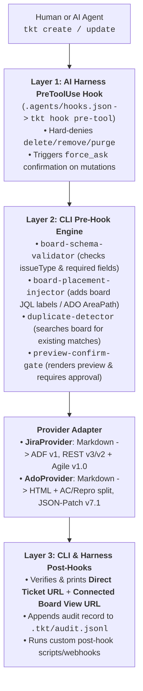

# `tkt` — Open-Source Board-Aware CLI for Jira & Azure DevOps (Human + AI Agent Ready)

`tkt` (`tkt-board-cli`) is a zero-dependency TypeScript/Node.js CLI tool and AI Agent harness that unifies **Atlassian Jira** (Cloud & Data Center) and **Microsoft Azure DevOps Boards** (`ADO`).

Unlike generic REST wrappers or raw MCP servers that treat issue trackers as flat databases, **`tkt` is Board-First**:
1. **Mandatory Board Selection During Setup (`tkt setup`)**: Connects to your project, lists all available boards (Scrum, Kanban, Product Discovery, Portfolio/Epic, Bug Triage), and lets you choose which board(s) to connect to.
2. **Deep Board Introspection (`tkt board-schema` / `tkt discover`)**: Automatically discovers the chosen board's **Columns $\leftrightarrow$ Statuses**, **JQL/WIQL Board Placement Rules** (required Jira filter labels or Azure DevOps Team `AreaPath` / `IterationPath`), and **Required/Custom Fields** per issue type.
3. **Structured Outputs Suited for Every Board**:
   - **Jira**: Converts Markdown (tables, code blocks, checklists, headings, inline marks) into native **Atlassian Document Format (ADF v1)** and auto-applies board filter labels so created tickets never disappear from the board.
   - **Azure DevOps**: Converts Markdown into clean HTML and **automatically splits `## Acceptance Criteria`, `## Repro Steps`, and `## System Info` into Azure DevOps's dedicated board fields** (`Microsoft.VSTS.Common.AcceptanceCriteria`, `Microsoft.VSTS.TCM.ReproSteps`, `Microsoft.VSTS.TCM.SystemInfo`) using `application/json-patch+json`.
   - **4 Output Modes**: `--format human` (terminal tables), `--format agent` (token-efficient LLM JSON), `--format json` (full board envelope), and `--format md` (Markdown tables/cards).
4. **Dual-Layer Pre-Hooks & Post-Hooks**:
   - **AI Agent Harness Hooks** ([.agents/hooks.json](.agents/hooks.json) `PreToolUse` & `PostToolUse` for Claude Code, Antigravity, Cursor)
   - **Built-in CLI Pre-Hooks & Post-Hooks** (Hard `no-delete` guard, board schema validation, automatic duplicate detection, mandatory preview confirmation, direct + board view deep-links, `.tkt/audit.jsonl` logging, and custom shell/webhook hooks).

---

## Why CLI + Skills + Hooks Over Raw Jira/ADO MCP? (What We Learned from MCP)

| Dimension | Raw Jira / ADO MCP Servers (`atlassian-mcp`, `azure-devops-mcp`) | `tkt` CLI + `.agents/skills/tkt-ops` + Pre/Post-Hooks |
| :--- | :--- | :--- |
| **Token & Context Overhead** | Injects 15–30 bulky tool schemas into every LLM turn (thousands of tokens before any work starts). | **Zero idle token cost.** Agent invokes `tkt` only when needed and receives compact `--format agent` outputs. |
| **Board Placement Awareness** | Creates tickets in the project abyss — often missing the board's JQL filter label or ADO Team `AreaPath`, so tickets never appear on the team's board. | **Board-First Setup:** Introspects the board during `tkt setup` and auto-injects required filter labels (Jira) or `AreaPath`/`IterationPath` (ADO). |
| **Pre-Hook Governance** | Generic MCP `executeWrite` tools make it difficult to block destructive actions or force human preview confirmation per board. | **Deterministic Pre-Hooks:** Hard-blocks `delete`/`remove`, checks duplicates, validates board fields, and forces a human confirmation preview before mutation. |
| **Post-Hook Verification** | Returns raw API JSON without board deep-links. | **Guaranteed Post-Hooks:** Always outputs both the **Direct Ticket URL** and the **Connected Board View URL** (`?selectedIssue=` / `?workitem=`), plus logs to `.tkt/audit.jsonl`. |
| **Best MCP Patterns Adopted** | `discover` schema check, duplicate search before filing, `Filed by:` attribution. | **Built right into `tkt`:** Includes `tkt discover`, automatic duplicate detection on `tkt create`, and structured templates! |

---

## Quickstart

### 1. Install & Build
```bash
npm install
npm run build
```

### 2. Connect to Jira and/or Azure DevOps (`tkt setup`)
- **For Humans (Interactive Wizard)**:
  ```bash
  node ./bin/tkt.js setup
  ```
- **For AI Agents (Step-by-Step Guide)**:
  Follow **[SETUP.md](SETUP.md)** and **[.agents/skills/tkt-ops/SKILL.md](.agents/skills/tkt-ops/SKILL.md)**.

---

## Architecture & Hook Pipeline



---

## CLI Command Reference

| Command | Description | Example |
| :--- | :--- | :--- |
| `tkt setup` | Interactive or flag-driven connection & **Board Selection** wizard | `tkt setup` |
| `tkt me` / `tkt test` | Verify credentials and display active profile + connected board | `tkt me` |
| `tkt profiles` | List all configured board profiles or switch default | `tkt profiles --set-default ado-main` |
| `tkt projects` | List accessible projects in Jira or Azure DevOps | `tkt projects --provider jira` |
| `tkt boards` | List all boards in a project | `tkt boards --project AIEAE` |
| `tkt board-schema` | Inspect connected board columns $\leftrightarrow$ statuses, placement rules & fields | `tkt board-schema --format md` |
| `tkt discover` | Refresh live board schema from Jira / Azure DevOps API | `tkt discover` |
| `tkt search [query]` | Search tickets on the connected board (`--board-only`, `--column`, `--type`) | `tkt search --board-only --format agent` |
| `tkt get <key>` | Get ticket details, board column, comments, and direct + board links | `tkt get AIEAE-1871` or `tkt get 1042` |
| `tkt transitions <key>` | List available workflow transitions and mapped Board Columns | `tkt transitions AIEAE-1871` |
| `tkt create` | Create a ticket on the connected board (with Pre-Hooks & Post-Hooks) | `tkt create -t Story -s "[Auth] Add SSO" --dry-run` |
| `tkt update <key>` | Update fields, comment, or move across Board Columns | `tkt update AIEAE-1871 --column "In Progress" -c "Started"` |
| `tkt template` | Print structured Markdown templates (`story`, `bug`, `epic`, `initiative`) | `tkt template --type bug` |

---

## Custom Pre-Hooks & Post-Hooks in `.tkt/config.json`

In addition to the built-in Pre-Hooks and Post-Hooks, any board profile in `.tkt/config.json` can register custom shell scripts or webhooks:

```json
{
  "governance": {
    "forbidDelete": true,
    "requireConfirmation": true,
    "enforceBoardSchema": true,
    "autoApplyBoardPlacement": true,
    "auditLog": true,
    "preHooks": [
      {
        "name": "lint-summary-prefix",
        "command": "node ./scripts/check-summary-prefix.js",
        "blocking": true
      }
    ],
    "postHooks": [
      {
        "name": "notify-slack-or-sync",
        "command": "echo \"Created $TKT_TICKET_KEY on $TKT_BOARD_URL\"",
        "blocking": false
      }
    ]
  }
}
```
