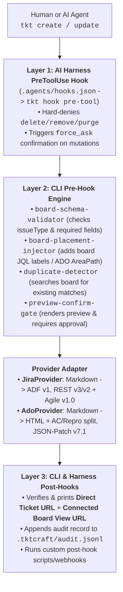

# `tktcraft` (`tkt`) — Open-Source Board-Aware CLI for Jira & Azure DevOps (Human + AI Agent Ready)

`tktcraft` (command: `tktcraft` or `tkt`) is a zero-dependency TypeScript/Node.js CLI tool and AI Agent harness that unifies **Atlassian Jira** (Cloud & Data Center) and **Microsoft Azure DevOps Boards** (`ADO`).

Unlike generic REST wrappers or raw MCP servers that treat issue trackers as flat databases, **`tkt` is Board-First**:
1. **Mandatory Board Selection During Setup (`tkt setup`)**: Connects to your project, lists all available boards (Scrum, Kanban, Product Discovery, Portfolio/Epic, Bug Triage), and lets you choose which board(s) to connect to.
2. **Deep Board Introspection (`tkt board-schema` / `tkt discover`)**: Automatically discovers the chosen board's **Columns $\leftrightarrow$ Statuses**, **JQL/WIQL Board Placement Rules** (required Jira filter labels or Azure DevOps Team `AreaPath` / `IterationPath`), and **Required/Custom Fields** per issue type.
3. **Structured Outputs Suited for Every Board**:
   - **Jira**: Converts Markdown (tables, code blocks, checklists, headings, inline marks) into native **Atlassian Document Format (ADF v1)** and auto-applies board filter labels so created tickets never disappear from the board.
   - **Azure DevOps**: Converts Markdown into clean HTML and **automatically splits `## Acceptance Criteria`, `## Repro Steps`, and `## System Info` into Azure DevOps's dedicated board fields** (`Microsoft.VSTS.Common.AcceptanceCriteria`, `Microsoft.VSTS.TCM.ReproSteps`, `Microsoft.VSTS.TCM.SystemInfo`) using `application/json-patch+json`.
   - **4 Output Modes**: `--format human` (terminal tables), `--format agent` (token-efficient LLM JSON), `--format json` (full board envelope), and `--format md` (Markdown tables/cards).
4. **Dual-Layer Pre-Hooks & Post-Hooks**:
   - **AI Agent Harness Hooks** ([.agents/hooks.json](.agents/hooks.json) `PreToolUse` & `PostToolUse` for Claude Code, Antigravity, Cursor)
   - **Built-in CLI Pre-Hooks & Post-Hooks** (Hard `no-delete` guard, board schema validation, automatic duplicate detection, mandatory preview confirmation, direct + board view deep-links, `.tktcraft/audit.jsonl` logging, and custom shell/webhook hooks).

---

Experimental Copilot integration is implemented in this unreleased candidate.
Setup installs the shared skill, hook registration, and minimal instructions
automatically. See the [verification status](COPILOT-COMPATIBILITY.md): installed
files are not proof of active enforcement or live-agent certification.
An unattended Copilot SDK probe continued after the hook returned `ask`.
Do not treat that response or an automatically allowed tool as human consent:
every mutation still requires the exact preview and explicit user approval.
Unattended Copilot ticket writes are not supported.

## Workspace layout

`tkt setup` keeps generated tktcraft files in one ignored directory:

```text
.tktcraft/
  .env                     # Credentials (mode 0600; private ACL on Windows)
  config.json              # Connected account, boards and governance
  boards/                  # Board guides and routing index
  hooks/tkt-hook.cjs        # Installed-package launcher
  skills/tkt-ops/           # Full workflow and template assets
  templates/               # Optional customized templates
  audit.jsonl
  pending-approval.json
  agent-integration.json
```

Only small compatibility entry points remain in the locations assistants
discover: `.agents/hooks.json`, `.github/hooks/tkt-governance.json`,
`.agents/skills/tkt-ops/SKILL.md`, and a managed instruction block. They point
inside `.tktcraft/`; no symlinks are required. Normal npm files stay in their
standard locations. Installing the package alone does not connect a board or
install these workspace integrations; run setup before starting a new chat.

Legacy `.tkt/` state migrates on first CLI access. If both state directories
exist, the CLI stops without overwriting either. Setup relocates legacy skill
resources, preserves custom content, and leaves a forwarding launcher only
where an older installation already had one. Root `.env` is a read-only
compatibility fallback: `.tktcraft/.env` wins, all new credential writes go
inside `.tktcraft/`, and unrelated root application settings are never moved.
Review hardcoded old paths in customized workflows after migration.

## Why CLI + Skills + Hooks Over Raw Jira/ADO MCP? (What We Learned from MCP)

| Dimension | Raw Jira / ADO MCP Servers (`atlassian-mcp`, `azure-devops-mcp`) | `tkt` CLI + `.agents/skills/tkt-ops` + Pre/Post-Hooks |
| :--- | :--- | :--- |
| **Token & Context Overhead** | Injects 15–30 bulky tool schemas into every LLM turn (thousands of tokens before any work starts). | **Zero idle token cost.** Agent invokes `tkt` only when needed and receives compact `--format agent` outputs. |
| **Board Placement Awareness** | Creates tickets in the project abyss — often missing the board's JQL filter label or ADO Team `AreaPath`, so tickets never appear on the team's board. | **Board-First Setup:** Introspects the board during `tkt setup` and auto-injects required filter labels (Jira) or `AreaPath`/`IterationPath` (ADO). |
| **Pre-Hook Governance** | Generic MCP `executeWrite` tools make it difficult to block destructive actions or force human preview confirmation per board. | **Deterministic Pre-Hooks:** Hard-blocks `delete`/`remove`, checks duplicates, validates board fields, and forces a human confirmation preview before mutation. |
| **Post-Hook Verification** | Returns raw API JSON without board deep-links. | **Guaranteed Post-Hooks:** Always outputs both the **Direct Ticket URL** and the **Connected Board View URL** (`?selectedIssue=` / `?workitem=`), plus logs to `.tktcraft/audit.jsonl`. |
| **Best MCP Patterns Adopted** | `discover` schema check, duplicate search before filing, `Filed by:` attribution. | **Built right into `tkt`:** Includes `tkt discover`, automatic duplicate detection on `tkt create`, and structured templates! |

---

## Quickstart

### 1. Install in Your Project
```bash
npm install tktcraft
npx --no-install tkt onboarding
```

### 2. Connect Your Board

Run `npx --no-install tkt setup` for the interactive wizard, or follow
[ONBOARDING.md](ONBOARDING.md) with your assistant. Provision credentials in an
ignored `.tktcraft/.env` file. Always list the boards and choose yours before connecting.
Setup installs agent integration files without asking you to select an agent.

For existing workspaces, update the installed package and rerun setup with your
selected project and board to install missing assets. Unmodified managed assets
upgrade safely; unrelated instructions/hooks stay intact and custom conflicts
are reported. Keep the package installation available for the hook launcher.

### 3. Start a New Assistant Session

Use a trusted workspace, inspect `/hooks` in your selected Copilot harness, and
check that the shared `tkt-ops` skill is discovered. Run a read-only command such
as `npx --no-install tkt board-schema` and inspect the hook diagnostics.
Neither copied files nor a successful direct CLI command certify activation.
Every write still needs a structured preview and explicit approval.

For source development, use `npm install && npm run build`; the source checkout
remains supported. These candidate integration changes are not published yet.

### Windows

The same commands work in PowerShell, cmd.exe and Git Bash; npm installs `tkt.cmd`
and `tkt.ps1` shims, and CI runs the test suite on Windows. Differences:

- In place of mode 0600, `.tktcraft/.env` drops the permissions it would inherit from the
  folder, leaving your account (and SYSTEM/Administrators, the Windows equivalents of root).
- Custom `preHooks`/`postHooks` commands run through `cmd.exe`. Use `node ./script.js`
  rather than shell syntax for hooks that must work on every OS.
- The agent hook treats a command as a preview only when bash, PowerShell and cmd.exe
  would all pass it a plain `--dry-run`. Dry-runs that use variables, `&`, `%`, `^`,
  comments, or `\` outside a path still ask for permission.

---

## Architecture & Hook Pipeline



---

## CLI Command Reference

| Command | Description | Example |
| :--- | :--- | :--- |
| `tkt setup` | Interactive or flag-driven connection & **Board Selection** wizard | `tkt setup` |
| `tkt me` / `tkt test` | Verify credentials and display active profile + connected board | `tkt me` |
| `tkt profiles` | List all configured board profiles or switch default | `tkt profiles --set-default ado-main` |
| `tkt projects` | List accessible projects in Jira or Azure DevOps | `tkt projects --provider jira` |
| `tkt boards` | List all boards in a project | `tkt boards --project AIEAE` |
| `tkt board-schema` | Inspect connected board columns $\leftrightarrow$ statuses, placement rules & fields | `tkt board-schema --format md` |
| `tkt discover` | Refresh live board schema from Jira / Azure DevOps API | `tkt discover` |
| `tkt search [query]` | Search tickets on the connected board (`--board-only`, `--column`, `--type`) | `tkt search --board-only --format agent` |
| `tkt get <key>` | Get ticket details, board column, comments, and direct + board links | `tkt get AIEAE-1871` or `tkt get 1042` |
| `tkt transitions <key>` | List available workflow transitions and mapped Board Columns | `tkt transitions AIEAE-1871` |
| `tkt create` | Create a ticket on the connected board (with Pre-Hooks & Post-Hooks) | `tkt create -t Story -s "[Auth] Add SSO" --dry-run` |
| `tkt update <key>` | Update fields, comment, or move across Board Columns | `tkt update AIEAE-1871 --column "In Progress" -c "Started"` |
| `tkt template` | Print structured Markdown templates (`story`, `bug`, `epic`, `initiative`) | `tkt template --type bug` |

---

## Custom Pre-Hooks & Post-Hooks in `.tktcraft/config.json`

In addition to the built-in Pre-Hooks and Post-Hooks, any board profile in `.tktcraft/config.json` can register custom shell scripts or webhooks:

```json
{
  "governance": {
    "forbidDelete": true,
    "requireConfirmation": true,
    "enforceBoardSchema": true,
    "autoApplyBoardPlacement": true,
    "auditLog": true,
    "preHooks": [
      {
        "name": "lint-summary-prefix",
        "command": "node ./scripts/check-summary-prefix.js",
        "blocking": true
      }
    ],
    "postHooks": [
      {
        "name": "notify-slack-or-sync",
        "command": "echo \"Created $TKT_TICKET_KEY on $TKT_BOARD_URL\"",
        "blocking": false
      }
    ]
  }
}
```

Hook commands run through the platform shell (`/bin/sh`, or `cmd.exe` on Windows),
so the `echo` example above is POSIX-only; a `node` script is portable.
